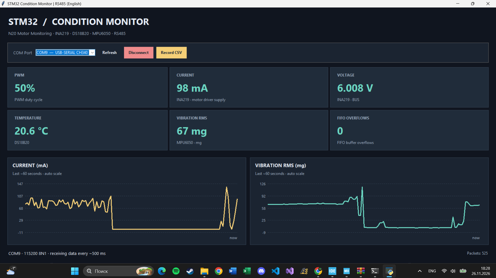
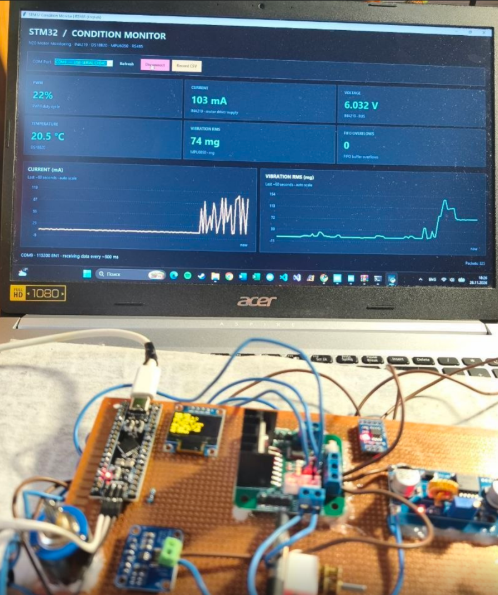
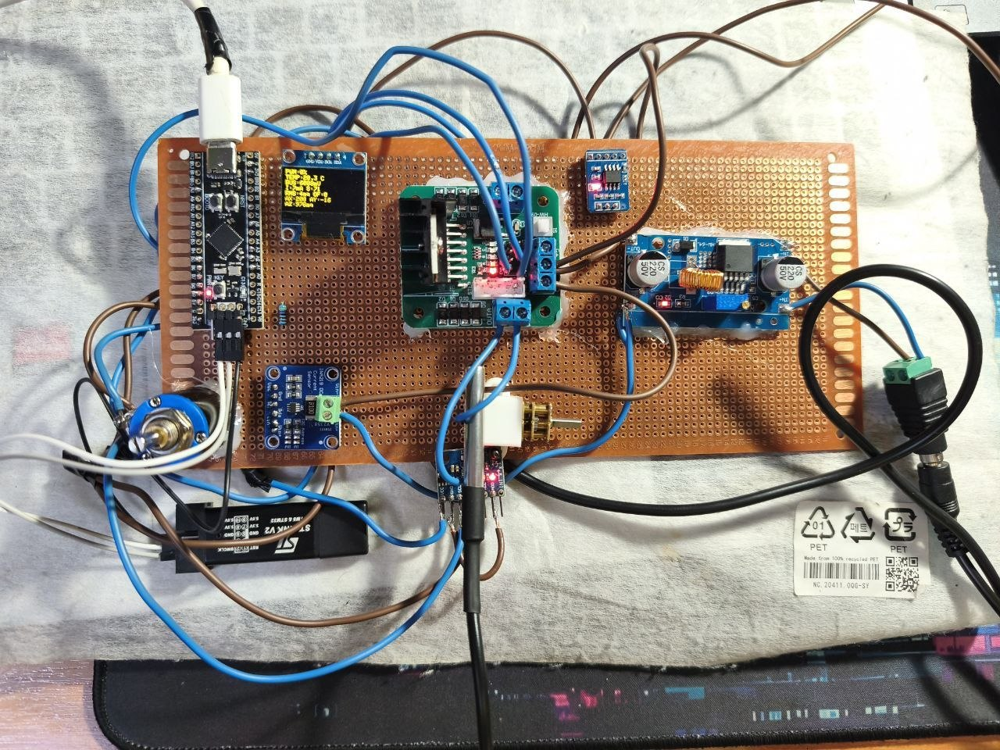

# STM32 Industrial Condition Monitoring System

An embedded condition-monitoring prototype for a **6 V N20 DC gearmotor**, built with an **STM32F411CEU6 Black Pill**. The controller measures motor supply voltage, current, temperature, and vibration, displays live values on an SSD1306 OLED, and streams telemetry over **RS485** to a Windows dashboard.

> **Status:** Working prototype. The STM32 firmware, connected sensors, motor PWM control, RS485 telemetry, and Python dashboard have been demonstrated together. This is a development prototype, not a certified industrial monitoring device.

## Demo



| Full setup | Hardware prototype |
|---|---|
|  |  |

## Features

- Adjustable motor speed with a 10 kΩ potentiometer and TIM3 PWM
- Live motor supply voltage and current from INA219
- DS18B20 temperature sensing
- MPU6050 accelerometer samples collected through FIFO, with vibration RMS calculated in firmware
- Local 128×64 SSD1306 I²C OLED display
- RS485 telemetry, **115200 baud, 8N1**, approximately every **500 ms**
- Windows application with live readings, current/vibration graphs and CSV recording

## Hardware

| Component | Role |
|---|---|
| STM32F411CEU6 Black Pill | Main microcontroller |
| N20 6 V DC gearmotor | Monitored motor |
| L298N motor driver | PWM motor drive |
| XL4015 DC-DC converter | Steps the 12 V input down to approximately 6 V for the motor |
| INA219 | Motor supply voltage/current measurements |
| MPU6050 / GY-521 | Accelerometer and vibration RMS |
| DS18B20 | Temperature sensor |
| SSD1306 128×64 OLED | Local status display |
| 10 kΩ potentiometer | Manual PWM setpoint |
| UART-to-RS485 module + USB-to-RS485 adapter | Connection to the PC |

### STM32 connections

| STM32 pin | Signal |
|---|---|
| PA1 (A1) | Potentiometer / ADC1_IN1 |
| PA6 (A6) | TIM3_CH1 PWM to motor driver |
| PB9 (B9) / PB5 (B5) | Motor direction controls |
| PB6 (B6) / PB7 (B7) | I²C1 SCL / SDA (OLED, INA219, MPU6050) |
| PA8 (A8) | DS18B20 1-Wire data (external pull-up to 3.3 V) |
| PA2 (A2) / PA3 (A3) | USART2 TX / RX for the RS485 transceiver |
| PB0 (B0) | RS485 direction-enable control |

**Power:** The 6 V motor is powered via a separate DC-DC converter, **not** from the STM32 GPIO or its 3.3 V rail. All interconnected modules must have an appropriate common ground, and external signals must be compatible with STM32 3.3 V logic.

## Serial telemetry protocol

This version uses a **simple ASCII/CSV protocol rather than Modbus RTU**.

```text
MON,uptime_ms,pwm_percent,bus_mV,current_mA,temp_x10,rms_mg,fifo_overflows
```

Example packet:

```text
MON,12500,50,6008,98,206,67,0
```

This means: uptime 12.5 s, PWM 50%, motor bus voltage 6.008 V, current 98 mA, temperature 20.6 °C, vibration RMS 67 mg, and zero FIFO overflows. Missing sensor readings are represented as `NA`.

**Port settings:** `115200`, `8N1`; data is sent about twice per second.

## Running the project

### STM32 firmware

1. Open the `.ioc` configuration and project in **STM32CubeIDE**.
2. Confirm the USART2 configuration is **115200 baud, 8 data bits, no parity, 1 stop bit**.
3. Build and flash the STM32 using ST-LINK/SWD.
4. Connect the external power stage according to the hardware wiring and use the OLED display to verify sensor readings.

### Windows dashboard

1. Install Python 3 and `pyserial`:

   ```powershell
   py -m pip install pyserial
   ```

2. Run the Python application (place the script in `pc/`, or adjust the path to match your checkout):

   ```powershell
   py pc/STM32_Condition_Monitor_EN.py
   ```

3. Choose the USB-RS485 COM port, connect, and optionally record measurements to CSV.

## Project structure

The intended GitHub layout is:

```text
STM32_Condition_Monitor/
├── Core/                  # Application and STM32 HAL integration
├── Drivers/               # STM32 HAL and CMSIS
├── Image/
│   ├── app.png
│   ├── full.png
│   └── setup_.jpg
├── pc/
│   └── STM32_Condition_Monitor_EN.py
├── STM32_Condition_Monitor.ioc
├── README.md
└── .gitignore
```

Other STM32CubeIDE-generated project configuration files, linker scripts, and SSD1306 library sources must also be retained for reproducible builds.

## Notes

- This project currently uses **RS485 UART telemetry, not Modbus RTU**.
- Measured RMS vibration depends on sensor placement, mechanical mounting and the selected sampling window; it is not a calibrated fault-detection threshold.
- This repository documents a working educational prototype. Further improvements could include UART DMA, alarm thresholds, fault classification, calibration and a custom PCB.

## License

No project-wide license is declared here. Third-party libraries (including the SSD1306 driver) retain their own applicable licenses.
